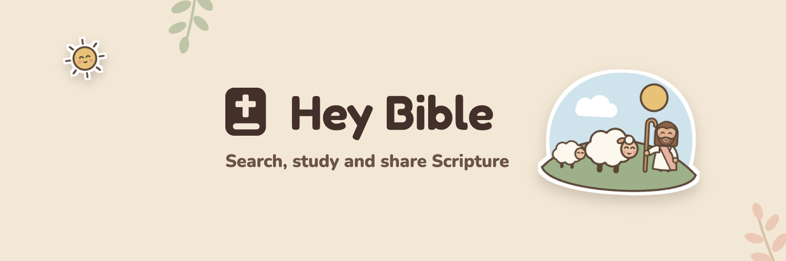
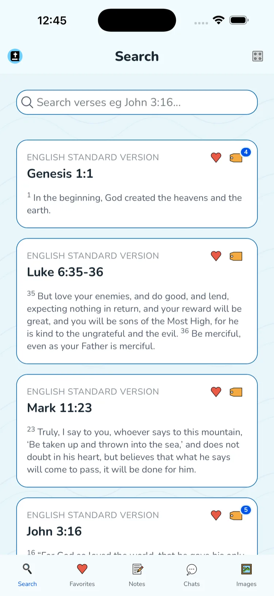
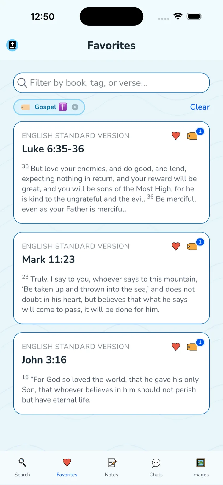
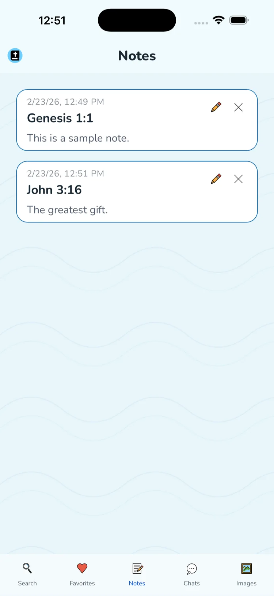
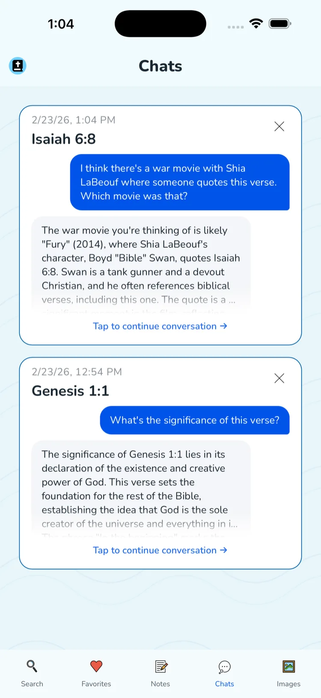
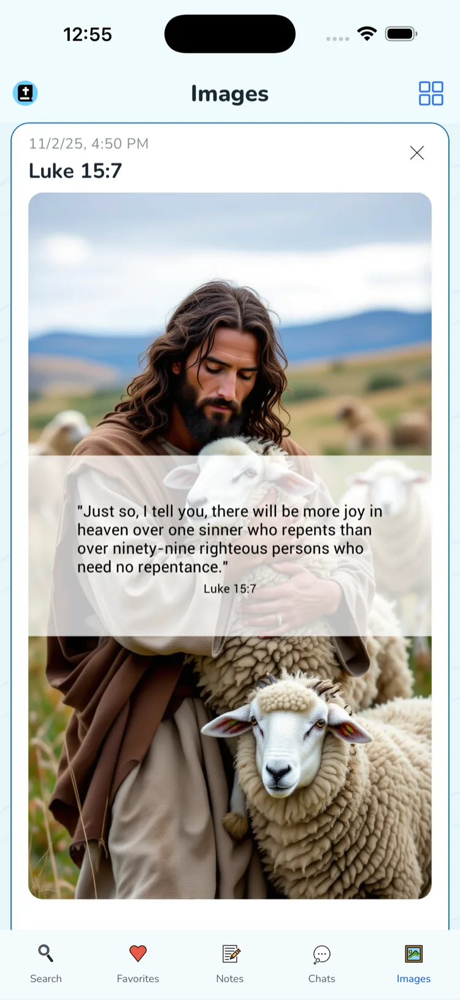
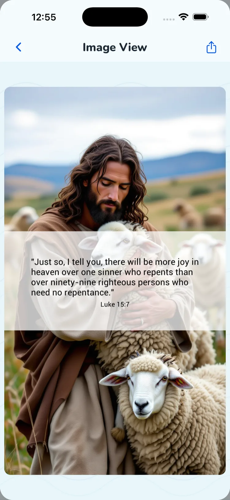
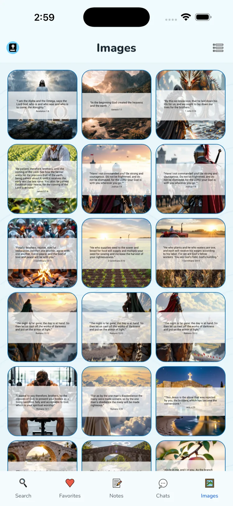
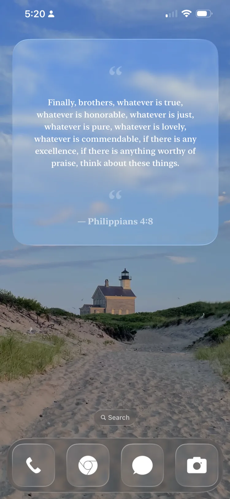

## Hey Bible ✝️

Hey Bible is an easy to use Bible verse lookup tool. With Hey Bible, you can quickly search and favorite verses take notes, and generate beautiful images of your favorite verses.

### Web

You can use Hey Bible on the web at [heybible.app](https://heybible.app).

### Mobile

Hey Bible is available on the [App Store](https://apps.apple.com/us/app/hey-bible/id6474075530) and [Google Play](https://play.google.com/store/apps/details?id=com.workingdevshero.heybible).

       

 

### Support

If you have any questions or feedback, please fill out [this form](https://app.youform.com/forms/o1pfzrgp) and we'll get back to you as soon as possible.

## Brand images

The share image, favicons, logo and social graphics are drawn from sources in
this repository, in the Storybook Sticker look the app uses.

- `brand/` holds the sources: `og-image.html`, `og-features.html` (the share
  image for the Features page), and under `brand/social/` the
  profile picture, X header, Facebook cover and a post template
  (`post.html`, which takes its words from the address — see the notes at the
  top of that file).
- `npm run brand:video` renders `public/video/og.mp4`, the share image in
  motion, from the same `og-image.html` (the movement is in
  `brand/motion.css`; open the page with `?play` to watch it). It also needs
  ffmpeg. The site offers it as `og:video`, which Messages plays in a link
  preview. `worker/` answers the Range requests Apple's player makes, which
  Cloudflare's static assets do not.
- `brand/store/hero.html` is the App Store product page header (3840×1646)
  and search results asset (3840×2560), each as a still and an 8-second loop
  in `brand/store/`. They are uploaded in App Store Connect and are not part
  of the published site. `npm run brand:video -- app-store` renders just
  those two loops.
- `npm run brand` renders them. It writes the share image, favicons and logo
  into `public/img/`, and the social graphics into `brand/social/png/`, which
  is not part of the published site.

It needs zsh, ImageMagick 7 and a browser for Playwright (`npx playwright install
chromium`, or Google Chrome).
